<div align="center">

# PTIT KTX

**ỨNG DỤNG QUẢN LÝ KÝ TÚC XÁ SINH VIÊN**

`v1.0.0` · `Java 26` · `JavaFX 27` · `SQLite` · `Windows`

</div>

---

# 01. Giới thiệu ứng dụng

**PTIT KTX** là ứng dụng quản lý ký túc xá sinh viên trên máy tính, được xây dựng trong khuôn khổ **bài tập lớn học phần Cơ sở dữ liệu** tại Học viện Công nghệ Bưu chính Viễn thông (PTIT).

Ứng dụng tập hợp các nghiệp vụ quản lý vào một giao diện chung: theo dõi sinh viên và phòng ở, quản lý khách thăm, dịch vụ, vé xe tháng, lượt gửi/lấy xe, hóa đơn và thống kê. Thông tin được lưu trong cơ sở dữ liệu quan hệ để các phân hệ có thể sử dụng dữ liệu nhất quán.

**Mục tiêu của dự án:**

- Quản lý thông tin ký túc xá theo các nhóm nghiệp vụ rõ ràng.

- Hỗ trợ tìm kiếm, cập nhật và tổng hợp dữ liệu thay cho việc theo dõi rời rạc.

- Minh họa cách kết hợp thiết kế CSDL, truy vấn dữ liệu và giao diện ứng dụng desktop.

**Đối tượng sử dụng:** người phụ trách quản lý ký túc xá và người muốn tìm hiểu, trải nghiệm một ứng dụng quản lý KTX phục vụ mục đích học tập.

---

# 02. Tính năng chính

Ứng dụng gồm **8 mục** truy cập từ thanh điều hướng bên trái:

| **Mục**                | **Chức năng**                                                                                                                                    |
|------------------------|--------------------------------------------------------------------------------------------------------------------------------------------------|
| **Tổng quan**          | Hiển thị tổng số sinh viên, số phòng, chỗ còn trống và dịch vụ hiện có; thống kê tỷ lệ lấp đầy, tình trạng từng phòng và các lối truy cập nhanh. |
| **Sinh viên**          | Xem, tìm kiếm, thêm, sửa và xóa hồ sơ sinh viên; theo dõi phòng ở, số phòng có người và sinh viên vào ở theo tháng.                              |
| **Phòng ở**            | Quản lý số phòng, loại phòng, đơn giá và sức chứa; xem số người đang ở, chỗ trống, trạng thái phòng và danh sách sinh viên theo phòng.           |
| **Khách thăm**         | Quản lý danh bạ khách, ghi nhận các lượt đến thăm và thống kê số lượt thăm theo thời gian.                                                       |
| **Dịch vụ**            | Quản lý danh mục dịch vụ, đơn giá; ghi nhận lịch sử sử dụng và tổng hợp chi phí dịch vụ của sinh viên trong khoảng thời gian được chọn.          |
| **Gửi xe**             | Quản lý vé xe tháng; tra cứu theo biển số; ghi nhận gửi/lấy xe, theo dõi xe trong bãi và tra cứu lịch sử cùng các khoản phí phát sinh.           |
| **Hóa đơn**            | Tổng hợp tiền phòng, dịch vụ, vé xe tháng và phí gửi xe phát sinh theo tháng; lọc theo sinh viên và hỗ trợ in danh sách.                         |
| **Thống kê Doanh thu** | Thống kê doanh thu dịch vụ theo tháng, biểu đồ so sánh giữa các dịch vụ và bảng xếp hạng sinh viên theo số lượt sử dụng hoặc tổng chi phí.       |

Dữ liệu hiển thị ở các màn hình thay đổi theo những bản ghi đang có trong CSDL và bộ lọc người dùng lựa chọn.

---

# 03. Giao diện thực tế

Các hình dưới đây được lấy từ phiên bản ứng dụng trong tài liệu Word của nhóm. Nhấn vào ảnh để xem kích thước đầy đủ.

### 3.1. Tổng quan ký túc xá

<p align="center">
  <a href="docs/screenshots/01-tong-quan.png">
    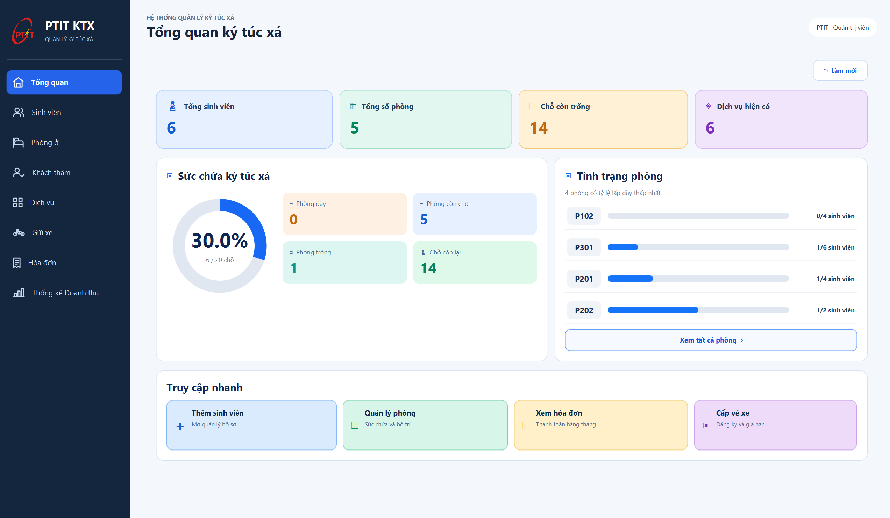
  </a>
</p>

### 3.2. Quản lý sinh viên

<p align="center">
  <a href="docs/screenshots/02-sinh-vien.png">
    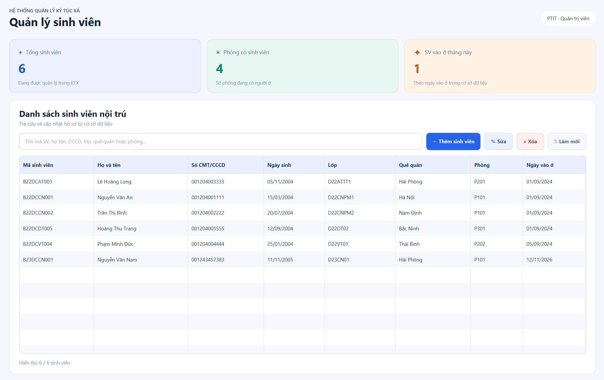
  </a>
</p>

### 3.3. Quản lý phòng ở

<p align="center">
  <a href="docs/screenshots/03-phong-o.png">
    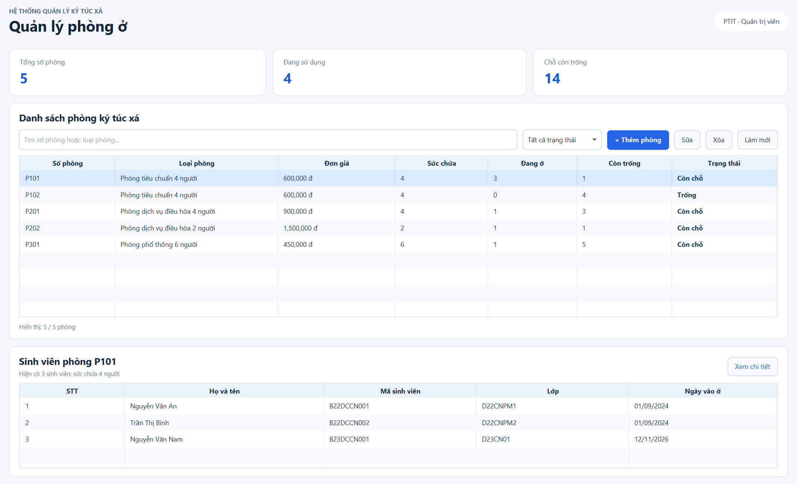
  </a>
</p>

### 3.4. Quản lý khách thăm

<p align="center">
  <a href="docs/screenshots/04-khach-tham-danh-ba.png">
    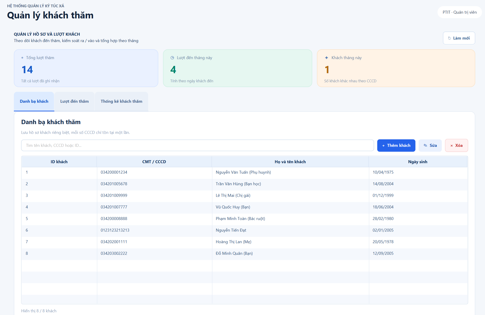
  </a>
</p>

<details>
<summary><b>Xem thêm các tab của phân hệ này</b></summary>

**Lượt đến thăm**

<p align="center">
  <a href="docs/screenshots/04-khach-tham-luot-tham.png">
    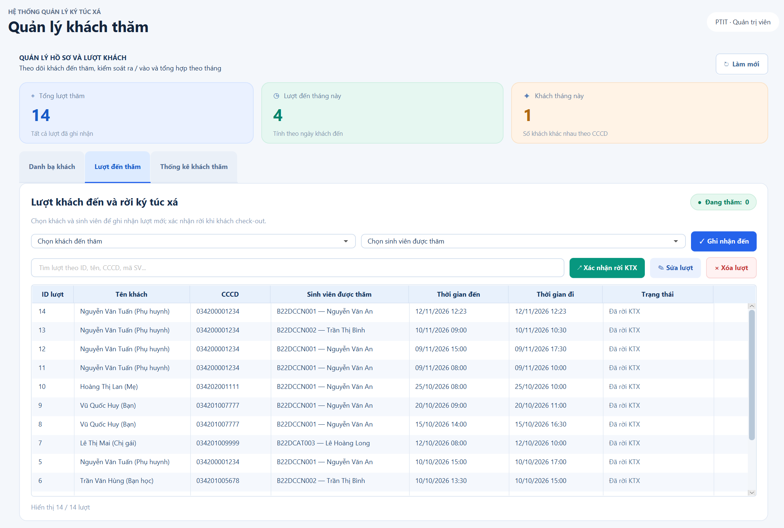
  </a>
</p>

**Thống kê khách thăm**

<p align="center">
  <a href="docs/screenshots/04-khach-tham-thong-ke.png">
    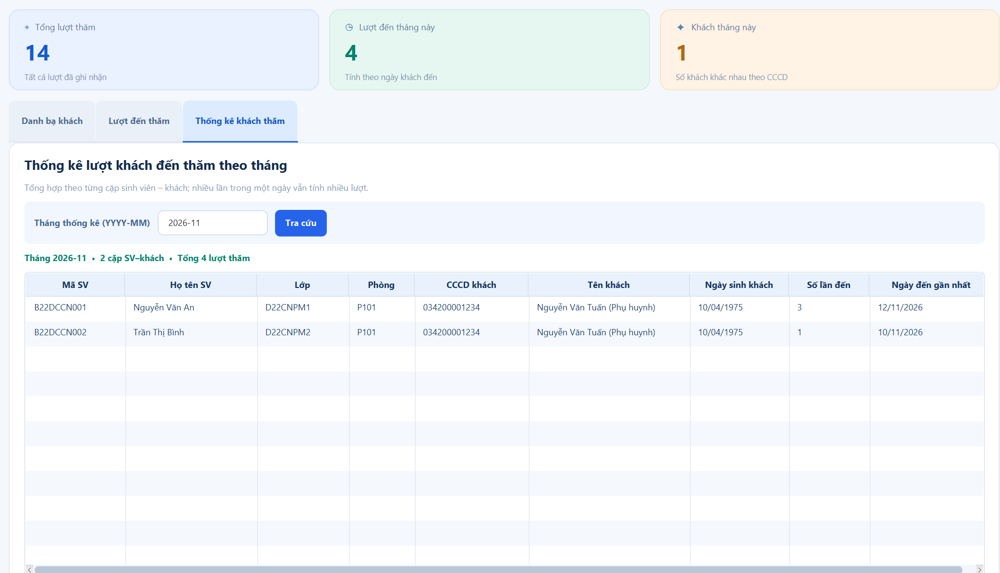
  </a>
</p>

</details>

### 3.5. Quản lý dịch vụ

<p align="center">
  <a href="docs/screenshots/05-dich-vu-danh-muc.png">
    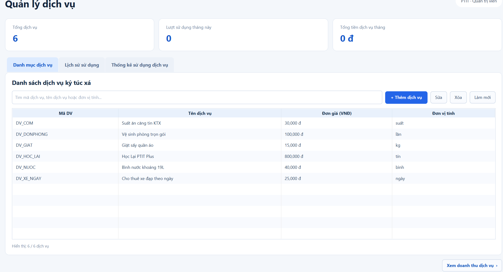
  </a>
</p>

<details>
<summary><b>Xem thêm các tab của phân hệ này</b></summary>

**Lịch sử sử dụng dịch vụ**

<p align="center">
  <a href="docs/screenshots/05-dich-vu-lich-su.png">
    
  </a>
</p>

**Thống kê sử dụng dịch vụ**

<p align="center">
  <a href="docs/screenshots/05-dich-vu-thong-ke.png">
    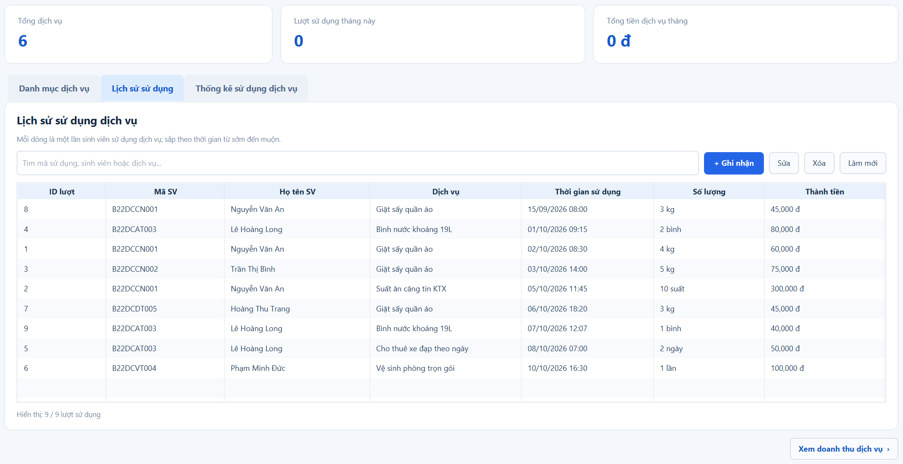
  </a>
</p>

</details>

### 3.6. Quản lý gửi xe

<p align="center">
  <a href="docs/screenshots/06-gui-xe-ve-thang.png">
    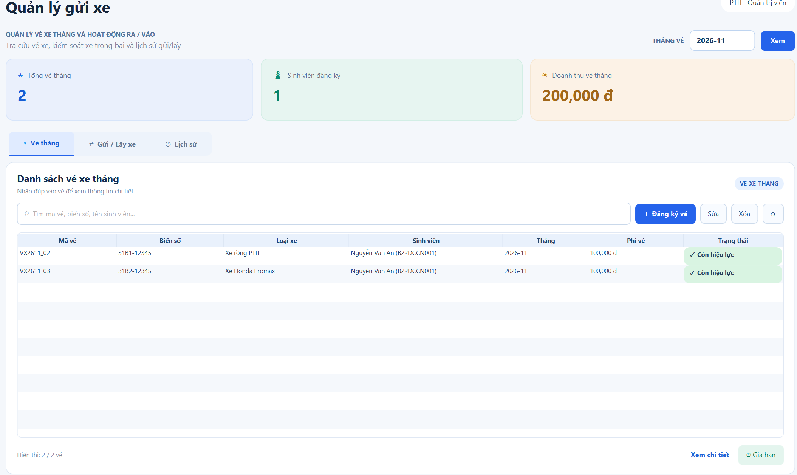
  </a>
</p>

<details>
<summary><b>Xem thêm các tab của phân hệ này</b></summary>

**Gửi / Lấy xe**

<p align="center">
  <a href="docs/screenshots/06-gui-xe-gui-lay.png">
    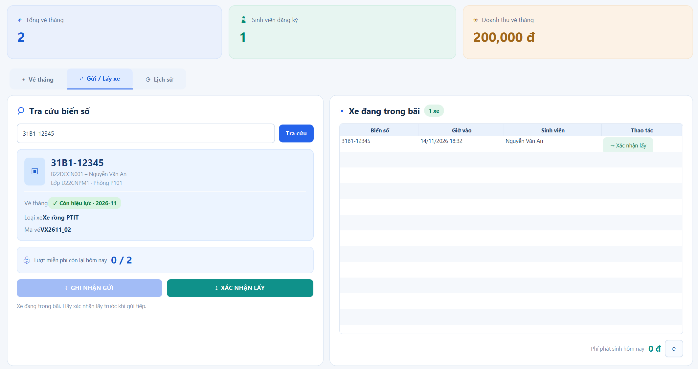
  </a>
</p>

**Lịch sử gửi / lấy xe**

<p align="center">
  <a href="docs/screenshots/06-gui-xe-lich-su.png">
    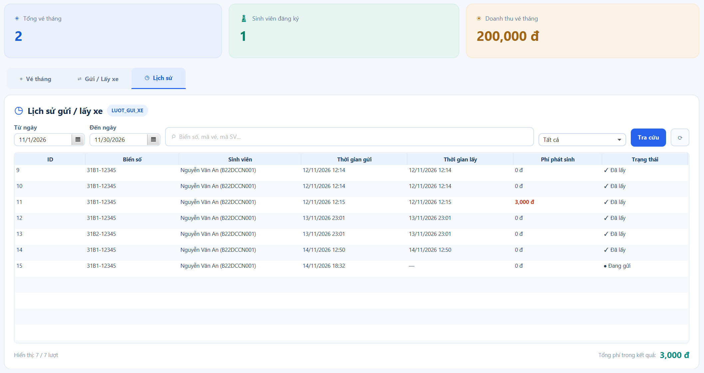
  </a>
</p>

</details>

### 3.7. Quản lý hóa đơn

<p align="center">
  <a href="docs/screenshots/07-hoa-don.png">
    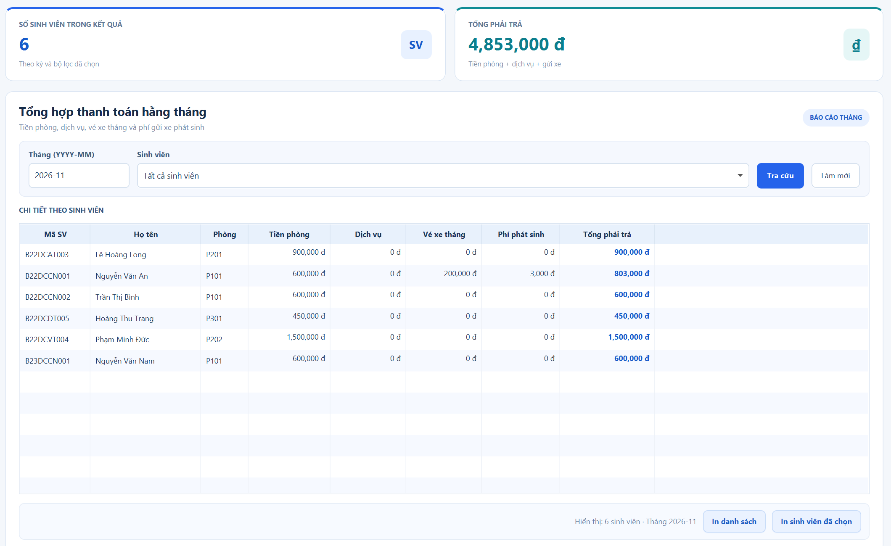
  </a>
</p>

### 3.8. Thống kê doanh thu

<p align="center">
  <a href="docs/screenshots/08-doanh-thu-bang.png">
    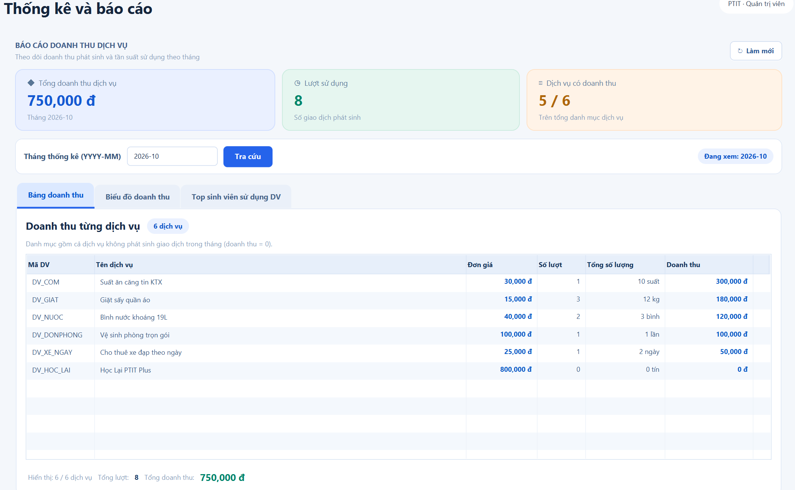
  </a>
</p>

<details>
<summary><b>Xem thêm các tab của phân hệ này</b></summary>

**Biểu đồ doanh thu**

<p align="center">
  <a href="docs/screenshots/08-doanh-thu-bieu-do.png">
    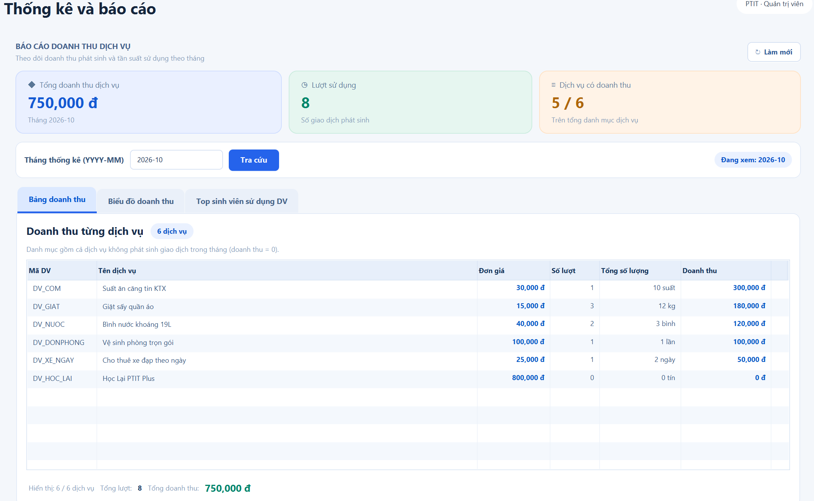
  </a>
</p>

**Top sinh viên sử dụng dịch vụ**

<p align="center">
  <a href="docs/screenshots/08-doanh-thu-top-sinh-vien.png">
    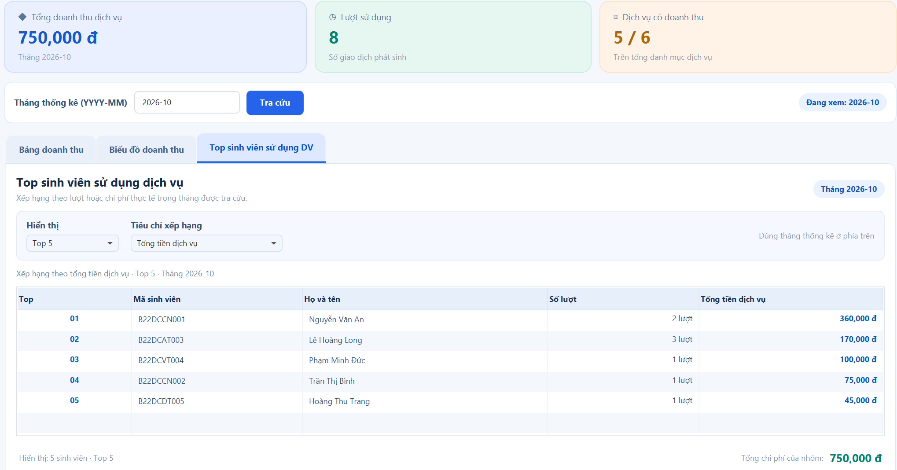
  </a>
</p>

</details>

---

# 04. Công nghệ sử dụng

| **Công nghệ**       | **Vai trò trong dự án**                                                                   |
|---------------------|-------------------------------------------------------------------------------------------|
| **Java 26**         | Ngôn ngữ lập trình; xây dựng các lớp dữ liệu và xử lý nghiệp vụ.                          |
| **JavaFX 27**       | Xây dựng giao diện desktop và xử lý tương tác với người dùng.                             |
| **FXML & CSS**      | Khai báo bố cục và định dạng giao diện; giúp tách phần hiển thị khỏi mã xử lý.            |
| **SQLite**          | CSDL quan hệ lưu dữ liệu trong tệp cục bộ; thuận tiện khi chạy ứng dụng trên máy cá nhân. |
| **Maven**           | Quản lý thư viện, cấu hình build và các tác vụ đóng gói.                                  |
| **Apache NetBeans** | Môi trường dùng để phát triển, chạy thử và quản lý mã nguồn.                              |

Dự án ban đầu sử dụng MySQL trong quá trình phát triển; **phiên bản Windows được phát hành sử dụng SQLite** nhằm giảm các bước cài đặt trên máy chạy ứng dụng.

---

# 05. Tải và chạy ứng dụng

## Yêu cầu

- **Hệ điều hành:** Windows.

- **Phiên bản phát hành:** v1.0.0.

- Không cần cài đặt riêng JDK, JavaFX hoặc MySQL **nếu sử dụng đúng gói phát hành kèm Java Runtime**.

## Các bước thực hiện

1. Trên GitHub, mở repository và chọn **Releases**.

2. Mở bản phát hành v1.0.0 – First Release và tải tệp .zip trong phần **Assets**.

3. Giải nén toàn bộ tệp ZIP vào một thư mục trên máy. **Không chạy trực tiếp từ trong file ZIP.**

4. Mở thư mục đã giải nén và chạy PTIT_KTX.exe.

5. Sử dụng menu bên trái để chuyển giữa các phân hệ quản lý.

**Lưu ý:** Giữ nguyên các tệp và thư mục đi kèm chương trình khi giải nén. Bản .exe hiện tại chỉ dành cho Windows; chưa có gói cài đặt riêng cho macOS hoặc Linux.

**Liên kết tải:** xem mục **Releases** ở phía bên phải trang repository trên GitHub. *(Có thể thay dòng này bằng URL cụ thể của bản phát hành khi hoàn tất đăng tải.)*

---

# 06. Cấu trúc và tổ chức dự án

Mã nguồn sử dụng cách tổ chức theo nhóm thành phần, tách dữ liệu, truy xuất CSDL và điều khiển giao diện:

```text
QuanLyKTX_SQLite/
├── src/
│   └── main/
│       ├── java/com/ptit/quanlyktx/
│       │   ├── App.java        # Khởi động giao diện
│       │   ├── Launcher.java   # Điểm chạy ứng dụng
│       │   ├── controller/     # Điều khiển các màn hình
│       │   ├── dao/            # Truy xuất dữ liệu
│       │   ├── database/       # Kết nối CSDL
│       │   ├── dto/            # Đối tượng truyền dữ liệu
│       │   └── model/          # Các lớp mô hình
│       └── resources/          # FXML, CSS và tài nguyên giao diện
├── docs/
│   └── screenshots/            # Ảnh giao diện dùng trong README
├── pom.xml                     # Cấu hình Maven
└── README.md                   # Giới thiệu dự án
```

> Sơ đồ trên là **cấu trúc rút gọn theo các nhóm package chính**

## Vai trò của các thành phần trong dự án

Mã nguồn của PTIT KTX được tổ chức thành các package và thư mục riêng biệt, giúp phân chia nhiệm vụ giữa các thành phần xử lý dữ liệu, nghiệp vụ và giao diện. Cấu trúc này giúp mã nguồn dễ theo dõi, chỉnh sửa và bảo trì.

### 1. Model – Mô hình dữ liệu

Package model chứa các lớp đại diện cho những đối tượng được quản lý trong ký túc xá, chẳng hạn như sinh viên, phòng ở, khách thăm, dịch vụ, hóa đơn và vé xe.

Mỗi lớp mô tả các thuộc tính của một đối tượng và cung cấp các phương thức cần thiết để truy cập, cập nhật dữ liệu. Model đóng vai trò trung gian trong việc trao đổi dữ liệu giữa các thành phần của ứng dụng.

### 2. DAO (Data Access Object) – Truy cập cơ sở dữ liệu

Package dao chứa các lớp phụ trách thao tác với cơ sở dữ liệu thông qua các câu lệnh SQL.

Các lớp DAO thực hiện những công việc như thêm, sửa, xóa, tìm kiếm, truy xuất và tổng hợp dữ liệu. Việc tách riêng DAO giúp hạn chế đặt câu lệnh SQL trực tiếp trong mã xử lý giao diện.

### 3. Database – Kết nối và quản lý cơ sở dữ liệu

Package database đảm nhiệm việc thiết lập và cung cấp kết nối giữa ứng dụng Java và cơ sở dữ liệu SQLite.

Thành phần này giúp tập trung cấu hình kết nối, hỗ trợ các lớp DAO truy cập dữ liệu và hạn chế việc lặp lại mã kết nối ở nhiều vị trí trong chương trình.

### 4. Controller – Điều khiển và xử lý tương tác

Package controller chứa các lớp điều khiển tương ứng với các màn hình chức năng của ứng dụng.

Controller tiếp nhận thao tác từ người dùng như nhấn nút, nhập thông tin, lựa chọn dữ liệu hoặc thực hiện tra cứu. Sau đó, Controller phối hợp với các lớp DAO và Model để xử lý yêu cầu, đồng thời cập nhật kết quả lên giao diện.

### 5. FXML – Định nghĩa bố cục giao diện

Các tệp .fxml mô tả cấu trúc của các màn hình JavaFX, bao gồm bảng dữ liệu, nút bấm, ô nhập liệu, nhãn thông tin và các thành phần giao diện khác.

FXML cho phép định nghĩa giao diện tách biệt với mã Java xử lý sự kiện, giúp việc thiết kế và điều chỉnh các màn hình thuận tiện hơn.

### 6. CSS – Định dạng và thống nhất giao diện

Các tệp .css quản lý cách hiển thị của ứng dụng, bao gồm màu sắc, phông chữ, kích thước, khoảng cách, đường viền và trạng thái của các thành phần.

Nhờ CSS, các màn hình có thể sử dụng chung một phong cách thiết kế, đồng thời việc thay đổi giao diện không yêu cầu chỉnh sửa trực tiếp logic xử lý dữ liệu.

### 7. Maven – Quản lý và xây dựng dự án

Tệp pom.xml lưu cấu hình Maven, khai báo các thư viện phụ thuộc và thiết lập quá trình biên dịch, chạy, đóng gói ứng dụng.

Maven hỗ trợ quản lý các thành phần cần thiết của dự án, giúp quá trình xây dựng và triển khai chương trình có tính nhất quán hơn.

---

# 07. Thông tin dự án

## 7.1. Thông tin chung

| **Thông tin**          | **Nội dung**                                    |
|------------------------|-------------------------------------------------|
| **Tên**                | PTIT KTX – Ứng dụng Quản lý Ký túc xá Sinh viên |
| **Học phần**           | Bài tập lớn Cơ sở dữ liệu                       |
| **Đơn vị**             | Học viện Công nghệ Bưu chính Viễn thông (PTIT)  |
| **Hình thức**          | Dự án nhóm sinh viên                            |
| **Loại ứng dụng**      | Desktop                                         |
| **Phiên bản**          | v1.0.0 – First Release                          |
| **CSDL bản phát hành** | SQLite                                          |
| **Nền tảng phát hành** | Windows                                         |

Dự án phục vụ mục đích học tập và thực hành phân tích, xây dựng một hệ thống quản lý có sử dụng CSDL quan hệ. Phần mô hình dữ liệu, các truy vấn SQL và báo cáo kiểm thử được trình bày trong tài liệu bài tập lớn riêng.

## 7.2. Nhóm triển khai

| **STT** | **Họ và tên**       | **Mã sinh viên** |
|---------|---------------------|------------------|
| **1**   | Đặng Minh Tuấn Anh  | B24DCCN015       |
| **2**   | Nguyễn Văn Nhật Anh | B24DCCN037       |

---

# 08. Cơ sở dữ liệu SQLite và phạm vi sử dụng

## 8.1. Tổ chức dữ liệu

PTIT KTX sử dụng **CSDL quan hệ** để lưu và liên kết dữ liệu giữa các nghiệp vụ. Các nhóm dữ liệu chính gồm:

- **Sinh viên – phòng ở:** thông tin sinh viên, phòng, sức chứa và tình trạng lưu trú.

- **Khách thăm:** hồ sơ khách và các lượt đến thăm.

- **Dịch vụ:** danh mục, đơn giá và lịch sử sử dụng dịch vụ của sinh viên.

- **Gửi xe:** vé xe tháng, lượt gửi/lấy và phí phát sinh.

- **Hóa đơn – thống kê:** tổng hợp chi phí, doanh thu từ các dữ liệu đã ghi nhận.

Các bảng và quan hệ cụ thể được mô tả trong báo cáo thiết kế cơ sở dữ liệu của nhóm.

## 8.2. Không cần cài CSDL

**Người dùng không cần cài MySQL Server hoặc một phần mềm quản trị SQLite riêng** để sử dụng bản Windows đã đóng gói. SQLite được ứng dụng truy cập trực tiếp thông qua tệp dữ liệu và thư viện kết nối đi kèm.

Khi di chuyển ứng dụng sang máy khác, cần sử dụng **đầy đủ gói phát hành** và bảo đảm chương trình có thể truy cập tệp CSDL theo đường dẫn đã cấu hình. Nếu cần sao lưu dữ liệu, nên đóng ứng dụng trước rồi sao chép **đúng tệp CSDL đang được sử dụng**; vị trí tệp phụ thuộc cấu hình của bản đóng gói.

## 8.3. Ưu điểm và giới hạn hiện tại

| **Ưu điểm**                                                                                                                                  | **Giới hạn**                                                                                                                                             |
|----------------------------------------------------------------------------------------------------------------------------------------------|----------------------------------------------------------------------------------------------------------------------------------------------------------|
| **Đa dạng chức năng:** Tích hợp nhiều chức năng quản lý thiết thực như sinh viên, phòng ở, khách thăm, dịch vụ, hóa đơn, gửi xe và thống kê. | **Giới hạn nền tảng:** Phiên bản hiện tại chỉ được đóng gói để chạy trên Windows, chưa có bản phát hành dành cho macOS và Linux.                         |
| **Giao diện thân thiện:** Bố cục rõ ràng, các chức năng được phân chia hợp lý, dễ tiếp cận và sử dụng.                                       | **Chưa hỗ trợ truy cập từ xa:** Ứng dụng hoạt động dưới dạng phần mềm desktop, chưa có phiên bản web hoặc ứng dụng di động.                              |
| **Quản lý thuận tiện:** Hỗ trợ tìm kiếm, cập nhật, theo dõi thông tin và tổng hợp dữ liệu trên cùng một hệ thống.                            | **Khả năng sử dụng đồng thời còn hạn chế:** Cơ sở dữ liệu SQLite được sử dụng cục bộ, chưa có cơ chế đồng bộ dữ liệu giữa nhiều máy tính.                |
| **Thống kê trực quan:** Cung cấp các chỉ số tổng quan, bảng thống kê và biểu đồ giúp người dùng theo dõi hoạt động ký túc xá.                | **Chức năng quản lý chưa toàn diện:** Một số nghiệp vụ nâng cao như phân quyền nhiều cấp, sao lưu dữ liệu tự động và gửi thông báo chưa được triển khai. |
